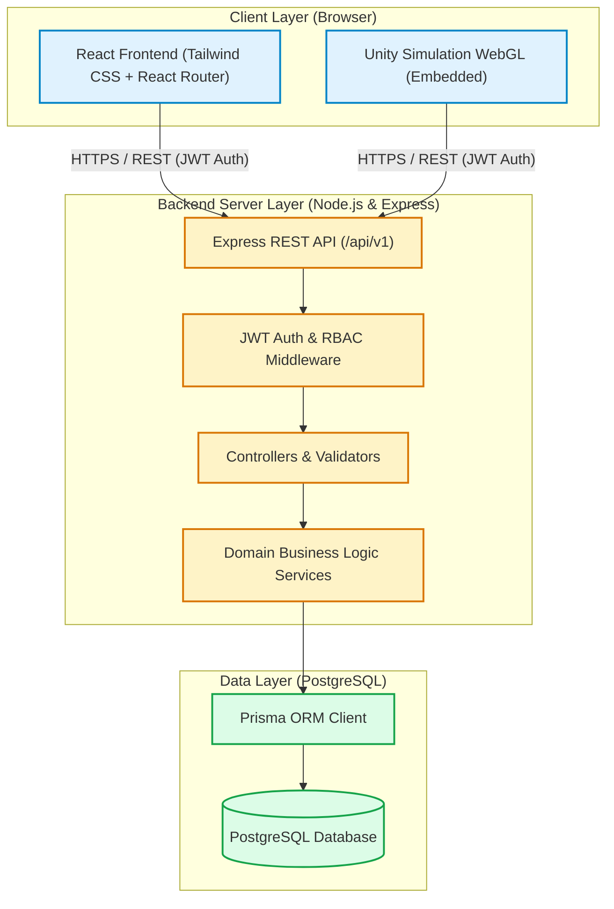

# DisasterReady 🚨

> **A Disaster Awareness, Preparedness, and Emergency Response Platform**

[](#project-status)
[](https://nodejs.org/)
[](https://www.prisma.io/)
[](https://react.dev/)
[](https://unity.com/)

---

## ⚠️ Important Notice: Project Status

> **CRITICAL:** This repository is currently in the **Initial Scaffolding & Architecture Phase (Phase 1)**.
>
> **No functional application code, APIs, UI components, authentication, or gameplay logic have been implemented yet.**
> All three developers are currently aligned on the database schema, system architecture, API contracts, and integration protocols documented in [`documentation/`](./documentation/). Functional implementation will commence sequentially according to the [Development Roadmap](./documentation/DEVELOPMENT_ROADMAP.md).

---

## 📖 Table of Contents

- [Problem Statement](#-problem-statement)
- [Project Overview & Objectives](#-project-overview--objectives)
- [Key Features](#-key-features)
- [Target User Roles](#-target-user-roles)
- [Technology Stack](#-technology-stack)
- [Project Directory Structure](#-project-directory-structure)
- [System Architecture Overview](#-system-architecture-overview)
- [Database & Data Models](#-database--data-models)
- [Team Responsibilities & Ownership](#-team-responsibilities--ownership)
- [Documentation Index](#-documentation-index)
- [Development Roadmap](#-development-roadmap)
- [License](#-license)

---

## 🌍 Problem Statement

During natural and human-induced disasters (earthquakes, flash floods, cyclones, wildfires, chemical hazards), widespread panic and casualties often arise not solely from the event itself, but from:

1. **A lack of prior awareness and realistic drill experience** among citizens.
2. **Fragmented, slow, or unverified alert dissemination** across communities.
3. **Information asymmetry** regarding the real-time location of safe shelters, hospitals, relief distribution hubs, and evacuation corridors.
4. **Ad-hoc incident reporting** that overwhelms emergency management authorities with duplicative or unverified calls.
5. **Absence of experiential learning tools** where people can safely practice emergency decision-making before facing real hazards.

---

## 🎯 Project Overview & Objectives

**DisasterReady** bridges the gap between public awareness, citizen preparedness, and authority coordination through a unified digital platform.

### Core Objectives:
- **Educate:** Provide interactive disaster guidelines, checklists, and realistic 3D WebGL simulation drills.
- **Alert:** Enable disaster management authorities to issue geofenced, severity-tiered alerts with near-zero latency.
- **Prepare:** Empower citizens to build customized emergency supply kits and register for neighborhood mock drills.
- **Respond:** Streamline community incident reporting and provide an interactive safe-shelter and emergency resource locator.
- **Coordinate:** Equip authorities with high-visibility dashboards to triage ground reports, broadcast advisories, and mobilize resources.

---

## 🌟 Key Features

1. **Disaster Awareness Hub:** Comprehensive educational guides, hazard prevention dos-and-don'ts, and preparedness checklists for various disaster types.
2. **Live Disaster Alerts:** Authority-issued, geolocated hazard warnings categorized by severity (`LOW`, `MODERATE`, `HIGH`, `CRITICAL`) with affected radii.
3. **Mock Drills & Training Registration:** Community disaster preparedness events and emergency mock drills with capacity caps and attendance tracking.
4. **Emergency Map & Safe Shelter Locator:** Geospatial finder for verified safe shelters, hospitals, fire stations, and supply distribution hubs.
5. **Emergency Assistance & Incident Reporting:** Citizen-submitted ground reports with GPS coordinates, descriptions, and media uploads, tracked through verification lifecycles.
6. **Personal Emergency Preparedness Kit:** Personalized checklist for water, non-perishable food, medical supplies, and critical documents with readiness indicators.
7. **Disaster Simulation Games (Unity WebGL):** In-browser 3D scenarios (e.g., Earthquake Evacuation, Flood Response) where users make split-second safety decisions and receive performance scores.
8. **Citizen Dashboard:** Centralized citizen portal for viewing active local alerts, tracked registrations, personal preparedness readiness, simulation records, and incident reports.
9. **Authority Dashboard:** Administrative command interface for broadcasting alerts, approving mock drills, verifying incident reports, and managing emergency shelters.
10. **Notifications & Updates:** Targeted notifications informing citizens about critical alerts, drill reminders, and report status resolutions.

---

## 👥 Target User Roles

- **`CITIZEN`**: Community members accessing awareness guides, building emergency kits, reporting localized incidents, registering for drills, and playing training simulations.
- **`AUTHORITY`**: Disaster management personnel, emergency services, and certified first-responders who issue alerts, schedule drills, triage reports, and manage resources.
- **`ADMIN`**: System administrators managing user accounts, platform configurations, and disaster taxonomy.
- *Future Extensibility:* Designed to accommodate institutional roles like **`SCHOOL`** or **`HOSPITAL_COORDINATOR`**.

---

## 🛠️ Technology Stack

| Layer | Technologies | Justification |
| :--- | :--- | :--- |
| **Frontend** | React 18, Tailwind CSS, React Router v6, Axios | Component-driven, responsive UI tailored for high-accessibility across mobile and desktop. |
| **Backend** | Node.js, Express.js, JWT, Zod/Joi | Lightweight, scalable asynchronous event-driven I/O handling high-throughput alert dispatch. |
| **Database & ORM** | PostgreSQL, Prisma ORM | Strongly-typed schema, ACID-compliant transactions, robust spatial queries, and declarative migrations. |
| **Simulation** | Unity (C#), Unity WebGL | Realistic 3D physics and decision-tree simulation playable directly in modern browsers without installs. |
| **Architectural Style** | Layered RESTful Service (`/api/v1`) | Clean separation of concerns (Routes → Middleware → Controllers → Services → Prisma). |

> **Architecture Boundary Rule:** The Unity WebGL client **never** connects directly to PostgreSQL. All gameplay state, scenario fetches, decision logs, and score submissions communicate strictly through the backend Express REST API over HTTPS with JWT authentication.

---

## 📁 Project Directory Structure

```text
DisasterReady/
├── frontend/                     # React + Tailwind CSS client application
├── backend/                      # Node.js + Express.js REST API server
│   └── prisma/
│       └── schema.prisma         # Normalized PostgreSQL schema with Prisma ORM
├── unity-game/                   # Unity 3D simulation source assets & WebGL build pipeline
├── documentation/                # Architectural blueprints, contracts, and roadmap
│   ├── ARCHITECTURE.md           # System architecture, request flow, and security design
│   ├── API_CONTRACTS.md          # Complete REST API specification (/api/v1)
│   ├── DATABASE_ERD.md           # Entity relationship documentation & schema reference
│   ├── database-erd.png          # High-resolution Entity Relationship Diagram (1800x1350)
│   ├── TEAM_RESPONSIBILITIES.md  # Detailed work ownership across the 3 developers
│   └── DEVELOPMENT_ROADMAP.md    # 14-phase development timeline & completion criteria
├── .gitignore                    # Comprehensive multi-environment Git ignore rules
└── README.md                     # Project overview and technical foundation
```

---

## 🏗️ System Architecture Overview



For complete technical specifications, see [ARCHITECTURE.md](./documentation/ARCHITECTURE.md).

---

## 🗄️ Database & Data Models

The PostgreSQL database is modeled with 12 normalized entities managed via Prisma:

1. **`User`**: Account identity, credentials, roles (`CITIZEN`, `AUTHORITY`, `ADMIN`), and contact details.
2. **`Disaster`**: Reference taxonomy for disaster types with baseline emergency guidelines.
3. **`Alert`**: Time-sensitive, geolocated incident warnings issued by authorities.
4. **`Event`**: Community training sessions and simulated drills organized by authorities.
5. **`Registration`**: User registrations for events with uniqueness enforcement (`userId` + `eventId`).
6. **`Notification`**: In-app notifications dispatched for alerts, updates, and drill reminders.
7. **`EmergencyResource`**: Standalone registry of physical shelters, hospitals, and water/supply depots.
8. **`IncidentReport`**: Citizen-submitted field reports undergoing review (`SUBMITTED` → `VERIFIED` → `RESOLVED`).
9. **`PreparednessItem`**: User-customized checklists for personal disaster grab-and-go kits.
10. **`SimulationScenario`**: Unity training scenarios with difficulty ratings and time caps.
11. **`SimulationAttempt`**: User gameplay sessions recording score, duration, and completion status.
12. **`SimulationDecision`**: Granular decision tracking capturing every in-game choice for learning analytics.

*Visual ER Diagram:* [`documentation/database-erd.png`](./documentation/database-erd.png)  
*Detailed Field Reference:* [`documentation/DATABASE_ERD.md`](./documentation/DATABASE_ERD.md)

---

## 👨‍💻 Team Responsibilities & Ownership

| Developer | Role & Domain | Primary Ownership |
| :--- | :--- | :--- |
| **Developer 1 (Lead)** | **Backend Developer** | PostgreSQL schema, Prisma ORM migrations, Express.js architecture, JWT authentication, RBAC middleware, `/api/v1/*` REST endpoints, simulation API endpoints, backend unit/integration testing. |
| **Developer 2** | **Frontend Developer** | Public marketing site, Citizen Dashboard, Authority Dashboard, authentication workflows, responsive Tailwind UI, client-side routing, API consumption with Axios, Unity WebGL canvas embedding. |
| **Developer 3** | **Simulation Developer** | Unity 3D scene construction, disaster physics and hazards, player controller mechanics, branching decision logic, real-time HUD, UnityWebRequest REST client, WebGL export optimization. |

For detailed workflow boundaries and collaboration protocols, refer to [TEAM_RESPONSIBILITIES.md](./documentation/TEAM_RESPONSIBILITIES.md).

---

## 📚 Documentation Index

All architectural contracts and plans are preserved in the [`documentation/`](./documentation/) directory:

- 📐 [**System Architecture (`ARCHITECTURE.md`)**](./documentation/ARCHITECTURE.md): Multi-tier architecture, request lifecycles, Unity WebGL bridging, and security standards.
- 📡 [**API Contracts (`API_CONTRACTS.md`)**](./documentation/API_CONTRACTS.md): 53 proposed REST API endpoints across 11 functional domains with request/response schemas.
- 🗃️ [**Database ERD Specification (`DATABASE_ERD.md`)**](./documentation/DATABASE_ERD.md): Detailed relational mapping, index strategies, and enum references.
- 🗺️ [**Development Roadmap (`DEVELOPMENT_ROADMAP.md`)**](./documentation/DEVELOPMENT_ROADMAP.md): 14 sequential development phases with completion criteria.
- 🤝 [**Team Responsibilities (`TEAM_RESPONSIBILITIES.md`)**](./documentation/TEAM_RESPONSIBILITIES.md): Clear technical ownership and integration workflows.

---

## 🗺️ Development Roadmap

```text
Phase 1: Project Architecture & Planning (COMPLETED)
Phase 2: Database Schema & Migrations
Phase 3: GitHub Setup & CI/CD Workflows
Phase 4: Backend Foundation & Server Scaffold
Phase 5: Authentication & Authorization (JWT + RBAC)
Phase 6: Backend REST API Implementation
Phase 7: Frontend Foundation & Base UI
Phase 8: Citizen Dashboard & Features
Phase 9: Authority Dashboard & Management
Phase 10: Unity Simulation Scenario Development
Phase 11: Unity-Backend API Integration
Phase 12: Complete Application Integration (WebGL Embed)
Phase 13: End-to-End Testing & Hardening
Phase 14: Cloud Deployment & Launch
```

---

## 📄 License

This project is developed as an academic and community disaster preparedness initiative. All rights reserved.

