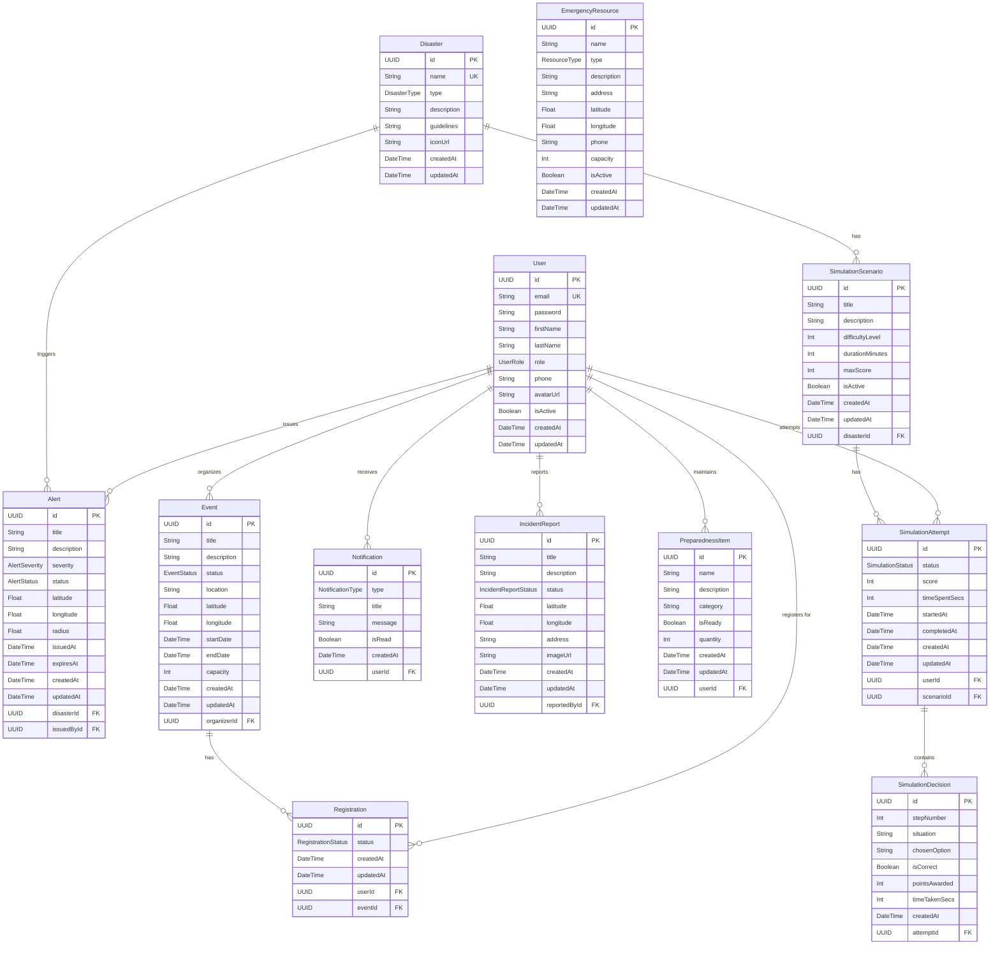

# Database Entity Relationship Diagram

> DisasterReady — Disaster Awareness, Preparedness & Emergency Response Platform

---

## 1. Overview

The DisasterReady platform uses **PostgreSQL** as its relational database, managed through **Prisma ORM**. The schema is designed around **12 core entities** that model every aspect of disaster management — from real-time alert dissemination and incident reporting to community event coordination and interactive simulation-based training.

Key design principles include:

- **UUID primary keys** across all tables for security and distributed-system compatibility.
- **Enum-driven categorization** for disaster types, alert severities, event statuses, and more — enforcing data integrity at the database level.
- **Normalized relationships** that connect users to their alerts, events, reports, preparedness kits, and simulation attempts.
- **Snake_case column mapping** (`@map`) for PostgreSQL naming conventions while retaining camelCase in the application layer.

---

## 2. Entity Relationship Diagram



---

## 3. Entities Description

### 3.1 User

| Aspect | Details |
|---|---|
| **Purpose** | Represents all platform users — citizens, government authorities, and administrators. Acts as the central identity entity linked to most other tables. |
| **Key Fields** | `id` (UUID PK), `email` (unique), `password` (hashed), `firstName`, `lastName`, `role` (CITIZEN / AUTHORITY / ADMIN), `isActive` (soft-delete flag) |
| **Relationships** | Issues **Alerts** · Organizes **Events** · Creates **Registrations** · Receives **Notifications** · Files **IncidentReports** · Maintains **PreparednessItems** · Makes **SimulationAttempts** |

### 3.2 Disaster

| Aspect | Details |
|---|---|
| **Purpose** | A master catalog of disaster types (earthquake, flood, cyclone, etc.) with preparedness guidelines. Serves as the foundation for alerts and training simulations. |
| **Key Fields** | `id` (UUID PK), `name` (unique), `type` (DisasterType enum), `description`, `guidelines` (optional preparedness text), `iconUrl` |
| **Relationships** | Triggers many **Alerts** · Has many **SimulationScenarios** |

### 3.3 Alert

| Aspect | Details |
|---|---|
| **Purpose** | Real-time disaster alerts issued by authorities. Supports geolocation-based targeting with latitude, longitude, and radius for area-of-effect notifications. |
| **Key Fields** | `id` (UUID PK), `title`, `severity` (LOW → CRITICAL), `status` (ACTIVE / EXPIRED / CANCELLED), `latitude`/`longitude`/`radius` (geo-targeting), `issuedAt`, `expiresAt` |
| **Relationships** | Belongs to one **Disaster** (`disasterId` FK) · Issued by one **User** (`issuedById` FK) |

### 3.4 Event

| Aspect | Details |
|---|---|
| **Purpose** | Community preparedness events such as drills, workshops, and training sessions organized by users (typically authorities). |
| **Key Fields** | `id` (UUID PK), `title`, `status` (UPCOMING / ONGOING / COMPLETED / CANCELLED), `location` (text address), `latitude`/`longitude`, `startDate`, `endDate`, `capacity` |
| **Relationships** | Organized by one **User** (`organizerId` FK) · Has many **Registrations** |

### 3.5 Registration

| Aspect | Details |
|---|---|
| **Purpose** | Tracks a user's registration for a community event. Enforces a composite unique constraint to prevent duplicate sign-ups. |
| **Key Fields** | `id` (UUID PK), `status` (REGISTERED / ATTENDED / CANCELLED), `userId` (FK), `eventId` (FK) |
| **Relationships** | Belongs to one **User** · Belongs to one **Event** |
| **Constraint** | `@@unique([userId, eventId])` — one registration per user per event |

### 3.6 Notification

| Aspect | Details |
|---|---|
| **Purpose** | In-app notifications delivered to users for alerts, event reminders, incident updates, and general announcements. |
| **Key Fields** | `id` (UUID PK), `type` (NotificationType enum), `title`, `message`, `isRead` (Boolean), `userId` (FK) |
| **Relationships** | Belongs to one **User** |

### 3.7 EmergencyResource

| Aspect | Details |
|---|---|
| **Purpose** | A directory of emergency infrastructure — shelters, hospitals, fire stations, supply centers, evacuation points, and more. Standalone entity not owned by any user. |
| **Key Fields** | `id` (UUID PK), `name`, `type` (ResourceType enum), `address`, `latitude`/`longitude`, `phone`, `capacity`, `isActive` (soft-delete flag) |
| **Relationships** | **None** — standalone entity with no foreign key dependencies |

### 3.8 IncidentReport

| Aspect | Details |
|---|---|
| **Purpose** | Citizen-submitted reports of incidents or hazards. Follows a review workflow (SUBMITTED → UNDER_REVIEW → VERIFIED/RESOLVED/REJECTED). |
| **Key Fields** | `id` (UUID PK), `title`, `description`, `status` (IncidentReportStatus), `latitude`/`longitude`, `address`, `imageUrl` (optional photo evidence) |
| **Relationships** | Reported by one **User** (`reportedById` FK) |

### 3.9 PreparednessItem

| Aspect | Details |
|---|---|
| **Purpose** | Personal emergency kit checklist items maintained by individual users. Tracks readiness and quantity for each supply item. |
| **Key Fields** | `id` (UUID PK), `name`, `category` (e.g., "First Aid", "Food", "Documents"), `isReady` (Boolean), `quantity` |
| **Relationships** | Belongs to one **User** (`userId` FK) |

### 3.10 SimulationScenario

| Aspect | Details |
|---|---|
| **Purpose** | Defines a disaster simulation training scenario tied to a specific disaster type. Configures difficulty, duration, and scoring parameters. |
| **Key Fields** | `id` (UUID PK), `title`, `description`, `difficultyLevel`, `durationMinutes`, `maxScore`, `isActive` |
| **Relationships** | Belongs to one **Disaster** (`disasterId` FK) · Has many **SimulationAttempts** |

### 3.11 SimulationAttempt

| Aspect | Details |
|---|---|
| **Purpose** | Records a single user's attempt at completing a simulation scenario, tracking progress, score, and time spent. |
| **Key Fields** | `id` (UUID PK), `status` (IN_PROGRESS / COMPLETED / ABANDONED), `score`, `timeSpentSecs`, `startedAt`, `completedAt` |
| **Relationships** | Belongs to one **User** (`userId` FK) · Belongs to one **SimulationScenario** (`scenarioId` FK) · Has many **SimulationDecisions** |

### 3.12 SimulationDecision

| Aspect | Details |
|---|---|
| **Purpose** | Captures each individual decision a user makes during a simulation — enabling granular gameplay analytics, step-by-step replay, and learning insights. |
| **Key Fields** | `id` (UUID PK), `stepNumber`, `situation` (scenario prompt text), `chosenOption`, `isCorrect`, `pointsAwarded`, `timeTakenSecs` |
| **Relationships** | Belongs to one **SimulationAttempt** (`attemptId` FK) |

---

## 4. Relationship Summary Table

| Relationship | Type | Description | Constraint |
|---|---|---|---|
| User → Alert | One-to-Many | A user (authority/admin) can issue multiple alerts | `issuedById` FK on Alert references User |
| User → Event | One-to-Many | A user can organize multiple community events | `organizerId` FK on Event references User |
| User → Registration | One-to-Many | A user can register for multiple events | `userId` FK on Registration references User |
| User → Notification | One-to-Many | A user receives multiple notifications | `userId` FK on Notification references User |
| User → IncidentReport | One-to-Many | A user can file multiple incident reports | `reportedById` FK on IncidentReport references User |
| User → PreparednessItem | One-to-Many | A user maintains multiple preparedness kit items | `userId` FK on PreparednessItem references User |
| User → SimulationAttempt | One-to-Many | A user can attempt multiple simulations | `userId` FK on SimulationAttempt references User |
| Disaster → Alert | One-to-Many | A disaster type can trigger multiple alerts | `disasterId` FK on Alert references Disaster |
| Disaster → SimulationScenario | One-to-Many | A disaster type can have multiple training scenarios | `disasterId` FK on SimulationScenario references Disaster |
| Event → Registration | One-to-Many | An event can have multiple registrations | `eventId` FK on Registration references Event |
| SimulationScenario → SimulationAttempt | One-to-Many | A scenario can be attempted multiple times | `scenarioId` FK on SimulationAttempt references SimulationScenario |
| SimulationAttempt → SimulationDecision | One-to-Many | An attempt contains multiple step-by-step decisions | `attemptId` FK on SimulationDecision references SimulationAttempt |
| User ↔ Event (via Registration) | Many-to-Many | Users register for events through the Registration join table | `@@unique([userId, eventId])` prevents duplicates |
| EmergencyResource | Standalone | Not related to any other entity via foreign keys | No FK constraints |

---

## 5. Enums Reference

### UserRole
| Value | Description |
|---|---|
| `CITIZEN` | General public user — can view alerts, register for events, file reports, and run simulations |
| `AUTHORITY` | Government or emergency official — can issue alerts and organize events |
| `ADMIN` | System administrator — full platform management access |

### DisasterType
| Value | Description |
|---|---|
| `EARTHQUAKE` | Seismic activity events |
| `FLOOD` | River, flash, or coastal flooding |
| `CYCLONE` | Tropical cyclones and hurricanes |
| `TSUNAMI` | Ocean-generated tidal waves |
| `WILDFIRE` | Uncontrolled forest or brush fires |
| `LANDSLIDE` | Earth or mudslide events |
| `DROUGHT` | Prolonged dry conditions |
| `VOLCANIC_ERUPTION` | Volcanic activity and eruptions |
| `TORNADO` | Violent rotating windstorms |
| `INDUSTRIAL_ACCIDENT` | Chemical spills, explosions, hazmat events |
| `OTHER` | Catch-all for uncategorized disaster types |

### AlertSeverity
| Value | Color Indication | Description |
|---|---|---|
| `LOW` | 🟢 Green | Informational — no immediate action required |
| `MODERATE` | 🟡 Yellow | Watch — situation developing, stay informed |
| `HIGH` | 🟠 Orange | Warning — take protective action soon |
| `CRITICAL` | 🔴 Red | Emergency — immediate action required |

### AlertStatus
| Value | Description |
|---|---|
| `ACTIVE` | Alert is currently in effect |
| `EXPIRED` | Alert has passed its expiration time |
| `CANCELLED` | Alert was manually cancelled by issuer |

### EventStatus
| Value | Description |
|---|---|
| `UPCOMING` | Event is scheduled but has not started |
| `ONGOING` | Event is currently in progress |
| `COMPLETED` | Event has concluded |
| `CANCELLED` | Event was cancelled |

### RegistrationStatus
| Value | Description |
|---|---|
| `REGISTERED` | User is signed up for the event |
| `ATTENDED` | User attended the event (post-event confirmation) |
| `CANCELLED` | User cancelled their registration |

### IncidentReportStatus
| Value | Description |
|---|---|
| `SUBMITTED` | Report filed by citizen, pending review |
| `UNDER_REVIEW` | Authority is reviewing the report |
| `VERIFIED` | Report confirmed as valid |
| `RESOLVED` | Incident has been addressed |
| `REJECTED` | Report was deemed invalid or duplicate |

### ResourceType
| Value | Description |
|---|---|
| `SHELTER` | Emergency shelter or safe haven |
| `HOSPITAL` | Hospital or medical facility |
| `FIRE_STATION` | Fire department station |
| `POLICE_STATION` | Law enforcement station |
| `SUPPLY_CENTER` | Emergency supplies distribution center |
| `EVACUATION_POINT` | Designated evacuation gathering point |
| `WATER_SOURCE` | Clean water distribution point |
| `OTHER` | Other emergency resource type |

### SimulationStatus
| Value | Description |
|---|---|
| `IN_PROGRESS` | User is currently running the simulation |
| `COMPLETED` | Simulation finished successfully |
| `ABANDONED` | User left the simulation before completion |

### NotificationType
| Value | Description |
|---|---|
| `ALERT` | Notification triggered by a new or updated alert |
| `EVENT_REMINDER` | Reminder for an upcoming registered event |
| `INCIDENT_UPDATE` | Status change on a filed incident report |
| `GENERAL` | General platform announcement |

---

## 6. Indexes

| Index / Constraint | Table | Column(s) | Type | Purpose |
|---|---|---|---|---|
| Primary Key | All tables | `id` | UUID, auto-generated | Unique identifier for every record |
| Unique | User | `email` | Unique index | Prevents duplicate user accounts |
| Unique | Disaster | `name` | Unique index | Ensures each disaster entry has a distinct name |
| Composite Unique | Registration | `[userId, eventId]` | Unique constraint | Prevents a user from registering for the same event twice |
| Foreign Key Index | Alert | `disasterId` | FK index | Fast lookup of alerts by disaster type |
| Foreign Key Index | Alert | `issuedById` | FK index | Fast lookup of alerts by issuing user |
| Foreign Key Index | Event | `organizerId` | FK index | Fast lookup of events by organizer |
| Foreign Key Index | Registration | `userId` | FK index | Fast lookup of registrations by user |
| Foreign Key Index | Registration | `eventId` | FK index | Fast lookup of registrations by event |
| Foreign Key Index | Notification | `userId` | FK index | Fast lookup of notifications by user |
| Foreign Key Index | IncidentReport | `reportedById` | FK index | Fast lookup of incident reports by reporter |
| Foreign Key Index | PreparednessItem | `userId` | FK index | Fast lookup of kit items by user |
| Foreign Key Index | SimulationScenario | `disasterId` | FK index | Fast lookup of scenarios by disaster type |
| Foreign Key Index | SimulationAttempt | `userId` | FK index | Fast lookup of attempts by user |
| Foreign Key Index | SimulationAttempt | `scenarioId` | FK index | Fast lookup of attempts by scenario |
| Foreign Key Index | SimulationDecision | `attemptId` | FK index | Fast lookup of decisions by attempt |

> [!NOTE]
> Prisma automatically creates indexes on foreign key columns and relation fields. Additional composite or custom indexes can be added via `@@index()` in the Prisma schema as query patterns evolve.

---

## 7. Design Decisions

### 7.1 UUID Primary Keys

All tables use **UUID v4** as their primary key instead of auto-incrementing integers.

| Benefit | Explanation |
|---|---|
| **Security** | UUIDs are non-sequential and unpredictable, preventing enumeration attacks (e.g., guessing `/api/users/2` after seeing `/api/users/1`) |
| **Distributed Compatibility** | UUIDs can be generated client-side or across multiple database nodes without coordination or collision risk |
| **Merge Safety** | When consolidating data from multiple sources or environments, UUIDs eliminate ID conflicts |

### 7.2 Composite Unique Constraint on Registration

```
@@unique([userId, eventId])
```

The `Registration` table enforces a **composite unique constraint** on `[userId, eventId]`. This guarantees that a user can only register once for any given event at the database level — eliminating the need for application-layer duplicate checks and preventing race conditions.

### 7.3 Separate SimulationDecision Table

Rather than storing simulation results as a single score, the schema captures **every individual decision** a user makes during a simulation in the `SimulationDecision` table. This enables:

- **Step-by-step replay** of a user's simulation run
- **Granular analytics** on which disaster situations users struggle with most
- **Learning insights** — identifying common wrong choices to improve training content
- **Time-per-step tracking** for performance analysis

### 7.4 EmergencyResource as a Standalone Entity

`EmergencyResource` has **no foreign key relationships** to any other table. This is intentional:

- Emergency resources (shelters, hospitals, fire stations) are **infrastructure-level data** — they exist independently of any user
- They are managed by administrators but not "owned" by them in a relational sense
- This keeps the resource directory decoupled and reusable across different platform features (maps, alerts, incident response)

### 7.5 Soft-Delete via `isActive` Flag

Instead of hard-deleting records, the `User` and `EmergencyResource` tables use a Boolean `isActive` flag:

| Advantage | Details |
|---|---|
| **Data Preservation** | Historical references remain intact — alerts issued by a deactivated user are not orphaned |
| **Audit Trail** | Deactivated records can still be queried for reporting and compliance |
| **Reversibility** | Accounts and resources can be reactivated without data loss |
| **Referential Integrity** | No cascading delete side-effects across the 7+ tables that reference User |

### 7.6 `@map` Annotations for Snake_Case PostgreSQL Columns

Prisma models use **camelCase** field names in the application layer (e.g., `firstName`, `createdAt`) while `@map` annotations translate them to **snake_case** in PostgreSQL (e.g., `first_name`, `created_at`).

```
firstName  String  @map("first_name")
createdAt  DateTime  @map("created_at")
```

This provides:

- **PostgreSQL convention compliance** — snake_case is the idiomatic naming standard for PostgreSQL
- **Application ergonomics** — TypeScript/JavaScript code uses natural camelCase
- **Query readability** — raw SQL queries against PostgreSQL use familiar column names

---

> [!TIP]
> To visualize and explore this schema interactively, run `npx prisma studio` from the project root. Prisma Studio provides a GUI for browsing data and relationships in your local database.
