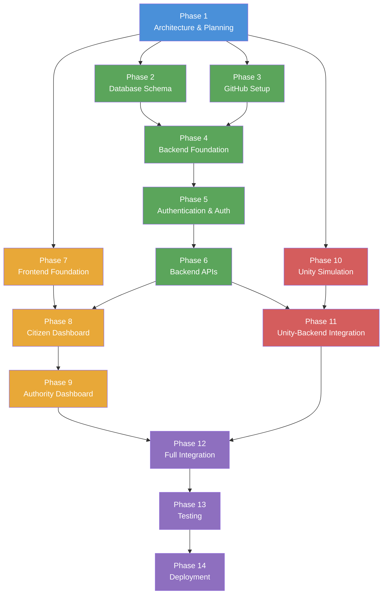

# DisasterReady — Development Roadmap

> **Version:** 1.0  
> **Last Updated:** November 2026  
> **Status:** Active  
> **Team Size:** 3 Developers (Backend, Frontend, Unity)

---

## Table of Contents

- [Overview](#overview)
- [Team Roles](#team-roles)
- [Phase 1: Project Architecture and Planning](#phase-1-project-architecture-and-planning)
- [Phase 2: Database Schema](#phase-2-database-schema)
- [Phase 3: GitHub Setup](#phase-3-github-setup)
- [Phase 4: Backend Foundation](#phase-4-backend-foundation)
- [Phase 5: Authentication and Authorization](#phase-5-authentication-and-authorization)
- [Phase 6: Backend APIs](#phase-6-backend-apis)
- [Phase 7: Frontend Foundation](#phase-7-frontend-foundation)
- [Phase 8: Citizen Dashboard](#phase-8-citizen-dashboard)
- [Phase 9: Authority Dashboard](#phase-9-authority-dashboard)
- [Phase 10: Unity Simulation](#phase-10-unity-simulation)
- [Phase 11: Unity–Backend Integration](#phase-11-unitybackend-integration)
- [Phase 12: Complete Application Integration](#phase-12-complete-application-integration)
- [Phase 13: Testing](#phase-13-testing)
- [Phase 14: Deployment](#phase-14-deployment)
- [Summary Timeline](#summary-timeline)
- [Phase Dependency Map](#phase-dependency-map)
- [Parallel Work Tracks](#parallel-work-tracks)

---

## Overview

This roadmap defines the complete development lifecycle for **DisasterReady** — a disaster awareness, preparedness, and emergency response platform. The project spans **14 phases** covering architecture, backend services, frontend interfaces, a Unity-based disaster simulation game, integration, testing, and production deployment.

### Tech Stack

| Layer | Technology |
|---|---|
| **Backend** | Node.js, Express.js, Prisma ORM |
| **Database** | PostgreSQL |
| **Frontend** | React.js (Vite), Tailwind CSS |
| **Simulation** | Unity Engine, C# |
| **Auth** | JWT (JSON Web Tokens) |

### Estimated Total Duration

**14–19 weeks** (approximately 3.5–5 months), accounting for parallel work tracks.

---

## Team Roles

| Role | Abbreviation | Primary Responsibilities |
|---|---|---|
| **Backend Developer** | `BE` | API development, database, auth, deployment infrastructure |
| **Frontend Developer** | `FE` | React UI, dashboards, integration with APIs |
| **Unity Developer** | `UE` | Simulation game development, WebGL builds, game–backend integration |

---

## Phase 1: Project Architecture and Planning

### Objective

Define the overall system architecture, database schema design, API contracts, and team workflows. Establish the foundational documentation that guides all subsequent development.

### Deliverables

| # | Deliverable | Description |
|---|---|---|
| 1 | `ARCHITECTURE.md` | System architecture document with component diagrams, data flow, and technology decisions |
| 2 | `API_CONTRACTS.md` | Complete REST API specification with endpoints, request/response schemas, status codes |
| 3 | `TEAM_RESPONSIBILITIES.md` | Role definitions, ownership areas, communication protocols |
| 4 | `schema.prisma` | Initial Prisma schema with all models, relations, and enums |
| 5 | `DATABASE_ERD.md` | Entity-Relationship Diagram documenting all database tables and relationships |
| 6 | `DEVELOPMENT_ROADMAP.md` | This document — phased plan with timelines and ownership |
| 7 | `README.md` | Project overview, setup instructions, and contribution guidelines |

### Completion Criteria

- [ ] All documentation files created and committed to repository
- [ ] Schema validated against API contract requirements
- [ ] All team members have reviewed and approved documentation
- [ ] No unresolved questions on architecture decisions

### Estimated Duration

**1 week**

### Owner(s)

**Backend Developer** (lead) — all team members review and provide feedback.

---

## Phase 2: Database Schema

### Objective

Finalize and validate the Prisma schema, execute the initial database migration, and create seed data for development and testing environments.

### Deliverables

| # | Deliverable | Description |
|---|---|---|
| 1 | Finalized `schema.prisma` | Production-ready schema with indexes, constraints, and defaults |
| 2 | Initial Prisma migration | First migration file generated and applied (`prisma migrate dev`) |
| 3 | Seed data script | `prisma/seed.ts` script that populates the database with realistic test data |

### Completion Criteria

- [ ] `npx prisma migrate dev` runs without errors
- [ ] All tables created with correct columns, types, and relations
- [ ] Seed script populates all tables with valid, representative data
- [ ] `npx prisma studio` shows correct data structure and relationships
- [ ] Schema matches the ERD documented in Phase 1

### Estimated Duration

**3–4 days**

### Owner(s)

**Backend Developer**

---

## Phase 3: GitHub Setup

### Objective

Set up the GitHub repository with proper branch protection, CI/CD pipelines, collaboration templates, and a documented branching strategy.

### Deliverables

| # | Deliverable | Description |
|---|---|---|
| 1 | GitHub repository | Mono-repo or linked repos with `main` and `develop` branches |
| 2 | Branch protection rules | `main`: require PR reviews, status checks. `develop`: require PR reviews |
| 3 | PR template | `.github/pull_request_template.md` with checklist for reviewers |
| 4 | Issue templates | Bug report, feature request, and task templates |
| 5 | CI workflow | GitHub Actions for linting (`ESLint`), formatting (`Prettier`), and test execution |
| 6 | `.gitignore` | Comprehensive ignore rules for Node.js, Unity, and IDE files |

### Completion Criteria

- [ ] All team members have repository access with appropriate permissions
- [ ] Branch protection rules enforced on `main` and `develop`
- [ ] CI workflow passes on a clean commit
- [ ] Branching strategy documented (e.g., `feature/*`, `bugfix/*`, `hotfix/*`)
- [ ] PR and issue templates render correctly on GitHub

### Estimated Duration

**1–2 days**

### Owner(s)

**Backend Developer**

---

## Phase 4: Backend Foundation

### Objective

Set up the Express.js project structure with a complete middleware stack, Prisma client integration, environment configuration, and foundational utilities.

### Deliverables

| # | Deliverable | Description |
|---|---|---|
| 1 | Express application | Main `app.js` / `server.js` with middleware chain |
| 2 | Folder structure | Organized directories: `routes/`, `controllers/`, `services/`, `middleware/`, `validators/`, `utils/`, `config/` |
| 3 | Prisma client setup | Singleton Prisma client instance with connection management |
| 4 | Environment configuration | `.env` support with validation (`dotenv`, `joi` or `zod` schema) |
| 5 | Error handling middleware | Global error handler with structured error responses |
| 6 | CORS configuration | Configurable CORS middleware for frontend origin |
| 7 | Health check endpoint | `GET /api/health` returning server and database status |
| 8 | Logging setup | Request logging with `morgan` or equivalent |

### Completion Criteria

- [ ] `npm run dev` starts the server without errors
- [ ] Server connects to PostgreSQL via Prisma successfully
- [ ] `GET /api/health` returns `200 OK` with `{ status: "ok", database: "connected" }`
- [ ] Invalid routes return structured `404` error responses
- [ ] Unhandled errors return structured `500` error responses
- [ ] CORS headers present in responses

### Estimated Duration

**1 week**

### Owner(s)

**Backend Developer**

---

## Phase 5: Authentication and Authorization

### Objective

Implement a complete JWT-based authentication system with role-based access control (RBAC) supporting `CITIZEN` and `AUTHORITY` roles.

### Deliverables

| # | Deliverable | Description |
|---|---|---|
| 1 | Registration endpoint | `POST /api/auth/register` — create user with hashed password |
| 2 | Login endpoint | `POST /api/auth/login` — validate credentials, return JWT |
| 3 | Logout endpoint | `POST /api/auth/logout` — invalidate token (if using blocklist) |
| 4 | Profile endpoint | `GET /api/auth/me` — return authenticated user's profile |
| 5 | JWT utilities | Token generation (`access` + optional `refresh`), verification, and extraction |
| 6 | Auth middleware | `authenticate` middleware that validates JWT on protected routes |
| 7 | Authorization middleware | `authorize(...roles)` middleware for role-based endpoint protection |
| 8 | Password hashing | `bcrypt`-based hashing with configurable salt rounds |
| 9 | Input validation | Request body validation for auth endpoints using `Joi` or `Zod` |

### Completion Criteria

- [ ] Users can register with valid data; duplicate emails are rejected
- [ ] Users can log in and receive a valid JWT token
- [ ] Protected endpoints reject requests without valid tokens (`401`)
- [ ] Role-restricted endpoints reject unauthorized roles (`403`)
- [ ] Passwords are never stored in plain text
- [ ] Auth errors return descriptive, structured responses

### Estimated Duration

**1 week**

### Owner(s)

**Backend Developer**

---

## Phase 6: Backend APIs

### Objective

Implement all REST API endpoints as defined in `API_CONTRACTS.md`, providing complete CRUD operations for every resource in the system.

### Deliverables

| # | Resource | Key Endpoints | Status |
|---|---|---|---|
| 1 | **Disasters** | CRUD for disaster types and information | ✅ Completed |
| 2 | **Alerts** | Create, list, update, delete alerts (authority); view active alerts (citizen) | ✅ Completed |
| 3 | **Events** | CRUD for disaster preparedness events | ✅ Completed |
| 4 | **Registrations** | Register/unregister for events; manage participant lists | ✅ Completed |
| 5 | **Notifications** | Create and deliver notifications; mark as read | ✅ Completed |
| 6 | **Emergency Resources** | CRUD for shelters, hospitals, emergency contacts | ✅ Completed |
| 7 | **Incident Reports** | Submit reports (citizen); review and update status (authority) | ✅ Completed |
| 8 | **Preparedness Kit** | Manage personal preparedness checklists | ✅ Completed |
| 9 | **Simulations** | CRUD for simulation scenarios, attempts, decisions, and scores | Pending |

### Completion Criteria

- [ ] All endpoints defined in `API_CONTRACTS.md` are implemented
- [ ] Each endpoint handles success and error cases with correct HTTP status codes
- [ ] Input validation applied on all `POST`/`PUT`/`PATCH` endpoints
- [ ] Authorization enforced — citizens cannot access authority-only endpoints
- [ ] Pagination implemented on list endpoints
- [ ] Endpoints tested manually or with automated tests (Postman/Jest)

### Estimated Duration

**2–3 weeks**

### Owner(s)

**Backend Developer**

> [!NOTE]
> This is the longest backend phase. Prioritize endpoints needed by the Frontend Developer first (auth, alerts, events) to unblock parallel work.

---

## Phase 7: Frontend Foundation

### Objective

Set up the React project with routing, base layout components, authentication pages, and an API service layer for backend communication.

### Deliverables

| # | Deliverable | Description |
|---|---|---|
| 1 | React + Vite project | Initialized with TypeScript (optional), configured build pipeline |
| 2 | Tailwind CSS | Installed and configured with custom theme (colors, fonts) |
| 3 | React Router | Route definitions for all application pages |
| 4 | Layout components | `Navbar`, `Footer`, `Sidebar`, `PageWrapper` |
| 5 | Auth pages | `Login` and `Register` pages with form validation |
| 6 | Protected route wrapper | `<ProtectedRoute>` component checking auth state and roles |
| 7 | API service layer | Axios instance with base URL, JWT interceptor, and error handling |
| 8 | Auth context/store | React Context or Zustand store for authentication state management |

### Completion Criteria

- [ ] `npm run dev` starts the frontend without errors
- [ ] Navigation between routes works correctly
- [ ] Login/Register forms submit to backend and handle responses
- [ ] Authenticated state persists across page refreshes (token in `localStorage`)
- [ ] Protected routes redirect unauthenticated users to login
- [ ] API calls include JWT token in `Authorization` header

### Estimated Duration

**1 week**

### Owner(s)

**Frontend Developer**

> [!TIP]
> This phase can start **in parallel with Phase 5** (Authentication). The Frontend Developer can build UI components and mock API responses while the Backend Developer implements auth endpoints.

---

## Phase 8: Citizen Dashboard

### Objective

Build all citizen-facing pages and features, providing a comprehensive interface for disaster awareness, preparedness, and community engagement.

### Deliverables

| # | Page/Feature | Description |
|---|---|---|
| 1 | **Dashboard Home** | Overview with active alerts count, upcoming events, kit progress |
| 2 | **Disaster Awareness Hub** | Browse disaster types with safety information and guidelines |
| 3 | **Live Alerts View** | Real-time alert feed with severity filtering and location info |
| 4 | **Events Listing** | Browse upcoming events with search, filter, and registration |
| 5 | **Event Registration** | Register/unregister for events; view registered events |
| 6 | **Preparedness Kit** | Interactive checklist for personal emergency preparedness |
| 7 | **Incident Report Form** | Submit incident reports with type, description, and location |
| 8 | **Notification Center** | View notifications with read/unread status and mark-as-read |
| 9 | **Simulation Game Page** | Container page for the Unity WebGL simulation (placeholder until Phase 12) |
| 10 | **User Profile** | View and edit profile information |

### Completion Criteria

- [ ] All pages render correctly with responsive design (mobile + desktop)
- [ ] Citizens can view active disaster alerts
- [ ] Citizens can browse and register for events
- [ ] Preparedness kit items can be added, checked, and removed
- [ ] Incident reports submit successfully to the backend
- [ ] Notifications display with correct read/unread state
- [ ] All pages fetch data from backend APIs

### Estimated Duration

**2–3 weeks**

### Owner(s)

**Frontend Developer**

---

## Phase 9: Authority Dashboard

### Objective

Build the authority-facing management interface, enabling officials to create alerts, manage events, review incident reports, and oversee emergency resources.

### Deliverables

| # | Page/Feature | Description |
|---|---|---|
| 1 | **Authority Dashboard Home** | Overview with statistics — total alerts, pending reports, active events |
| 2 | **Alert Management** | Create, edit, activate/deactivate, and delete alerts |
| 3 | **Event Management** | Create, edit, and delete events; view participant lists |
| 4 | **Incident Report Review** | View submitted reports; update status (pending → reviewing → resolved) |
| 5 | **Emergency Resource Management** | CRUD for shelters, hospitals, emergency contacts, supply depots |
| 6 | **Registration Management** | View and manage event registrations; export participant data |

### Completion Criteria

- [ ] Authority dashboard accessible only to users with `AUTHORITY` role
- [ ] Authorities can create and manage alerts (full lifecycle)
- [ ] Authorities can create and manage events with participant tracking
- [ ] Incident reports can be reviewed and status-updated
- [ ] Emergency resources can be added, edited, and removed
- [ ] All management tables support sorting and pagination
- [ ] Role-based navigation shows correct menu items per user role

### Estimated Duration

**2 weeks**

### Owner(s)

**Frontend Developer**

---

## Phase 10: Unity Simulation

### Objective

Build interactive disaster simulation scenarios in Unity that educate users through decision-based gameplay, providing a hands-on learning experience for disaster preparedness.

### Deliverables

| # | Deliverable | Description |
|---|---|---|
| 1 | Unity project setup | Configured project with folder structure, input system, and scene management |
| 2 | **Earthquake scenario** | Simulated earthquake with decision points (e.g., drop-cover-hold, evacuate) |
| 3 | **Flood scenario** | Rising water simulation with evacuation route decisions |
| 4 | **Fire scenario** | Building fire with escape route and safety protocol decisions |
| 5 | Player controller | First-person or third-person character movement and interaction system |
| 6 | Decision system | Branching decision UI with timed choices and consequence feedback |
| 7 | Scoring system | Points based on correct decisions, time taken, and survival outcome |
| 8 | In-game UI | HUD with health/safety meter, timer, decision prompts, and score display |
| 9 | Results screen | Post-scenario summary with score, correct/incorrect decisions, and tips |

### Completion Criteria

- [ ] At least 2–3 disaster scenarios are fully playable in Unity Editor
- [ ] Player can navigate environments and interact with objects
- [ ] Decision points trigger correctly with timed responses
- [ ] Scoring system calculates and displays accurate results
- [ ] Each scenario has a clear win/fail condition
- [ ] In-game UI is functional and responsive

### Estimated Duration

**3–4 weeks**

### Owner(s)

**Unity Developer**

> [!TIP]
> This phase can start **in parallel with Phase 6** (Backend APIs). The Unity Developer does not depend on backend APIs until Phase 11 (integration).

---

## Phase 11: Unity–Backend Integration

### Objective

Connect the Unity simulation game to the Express.js backend, enabling scenario data fetching, attempt tracking, decision submission, and score persistence.

### Deliverables

| # | Deliverable | Description |
|---|---|---|
| 1 | API client in Unity | `UnityWebRequest`-based HTTP client for REST API communication |
| 2 | JWT auth in Unity | Token storage and inclusion in API request headers |
| 3 | Scenario fetching | Load simulation scenarios and configuration from backend |
| 4 | Attempt tracking | Start/end simulation attempts via API calls |
| 5 | Decision submission | Submit player decisions to backend during gameplay |
| 6 | Score submission | Post final scores to backend on scenario completion |
| 7 | WebGL build | Unity project exported as WebGL build for browser embedding |

### Completion Criteria

- [ ] Unity game authenticates with backend using JWT
- [ ] Scenarios load dynamically from backend API
- [ ] Player decisions are recorded in the database
- [ ] Final scores persist in the database and appear on the user profile
- [ ] WebGL build runs in modern browsers (Chrome, Firefox, Edge)
- [ ] No CORS or mixed-content errors in WebGL context

### Estimated Duration

**1–2 weeks**

### Owner(s)

**Unity Developer** (lead) + **Backend Developer** (API support)

---

## Phase 12: Complete Application Integration

### Objective

Integrate all three components — backend, frontend, and Unity simulation — into a cohesive, working application with seamless user flows.

### Deliverables

| # | Deliverable | Description |
|---|---|---|
| 1 | Unity WebGL embedding | Unity WebGL build embedded in the React simulation page via `<iframe>` or `react-unity-webgl` |
| 2 | Cross-component auth | Shared JWT token between React frontend and Unity game |
| 3 | End-to-end user flows | Complete journeys tested: registration → login → dashboard → simulation → results |
| 4 | Cross-component bug fixes | Issues discovered during integration resolved |
| 5 | UI/UX polish | Consistent styling, loading states, error states, and transitions |

### Completion Criteria

- [ ] Unity simulation loads within the React application
- [ ] User can navigate from dashboard to simulation and back without issues
- [ ] Simulation scores appear on the user profile/dashboard after gameplay
- [ ] No broken links, dead routes, or orphaned pages
- [ ] Consistent visual design across all pages
- [ ] Application works on Chrome, Firefox, and Edge

### Estimated Duration

**1–2 weeks**

### Owner(s)

**All developers** (collaborative effort)

---

## Phase 13: Testing

### Objective

Conduct comprehensive testing across all components to ensure reliability, security, and performance before production deployment.

### Deliverables

| # | Test Type | Scope | Tools |
|---|---|---|---|
| 1 | **Backend unit tests** | Services, utilities, validators | Jest |
| 2 | **API integration tests** | All REST endpoints | Supertest + Jest |
| 3 | **Frontend component tests** | React components and hooks | React Testing Library, Vitest |
| 4 | **End-to-end tests** | Critical user journeys | Cypress or Playwright |
| 5 | **Unity play tests** | Scenario gameplay, decision logic, scoring | Unity Test Framework |
| 6 | **Performance testing** | API response times, load testing | Artillery or k6 |
| 7 | **Security testing** | Auth bypass, injection, XSS, CSRF | Manual review + OWASP checklist |

### Completion Criteria

- [ ] Backend test coverage > **80%** (statements)
- [ ] All critical user paths covered by E2E tests
- [ ] No **critical** or **high-severity** bugs open
- [ ] API response times under **500ms** for standard operations
- [ ] No known security vulnerabilities (SQL injection, XSS, auth bypass)
- [ ] All tests pass in CI pipeline

### Estimated Duration

**1–2 weeks**

### Owner(s)

| Component | Owner |
|---|---|
| Backend tests | Backend Developer |
| Frontend tests | Frontend Developer |
| Unity tests | Unity Developer |
| E2E tests | Frontend Developer (lead), all support |
| Security review | Backend Developer (lead), all support |

---

## Phase 14: Deployment

### Objective

Deploy the complete application to production infrastructure, configure domains, SSL, and environment variables, and verify all features work in the production environment.

### Deliverables

| # | Deliverable | Platform | Description |
|---|---|---|---|
| 1 | **Frontend deployment** | Vercel or Netlify | React app deployed with production build |
| 2 | **Backend deployment** | Railway or Render | Express.js API server with auto-deploy |
| 3 | **Database hosting** | Supabase or Railway | Managed PostgreSQL with backups |
| 4 | **Unity WebGL hosting** | CDN or static hosting | WebGL build served alongside frontend |
| 5 | **Environment variables** | All platforms | Production secrets configured securely |
| 6 | **Domain setup** | DNS provider | Custom domain with proper DNS records |
| 7 | **SSL certificates** | Hosting platform | HTTPS enforced on all endpoints |
| 8 | **Monitoring** | Platform built-in | Basic uptime monitoring and error alerts |

### Completion Criteria

- [ ] Application accessible via production URL over HTTPS
- [ ] All features functional in production environment
- [ ] Database migrations applied to production database
- [ ] Environment variables set (never committed to repository)
- [ ] WebGL simulation loads and communicates with production API
- [ ] No mixed-content warnings in browser console
- [ ] Basic monitoring/alerting configured

### Estimated Duration

**1 week**

### Owner(s)

**Backend Developer** (lead) — all developers support and verify their components.

---

## Summary Timeline

| Phase | Name | Duration | Owner(s) | Dependencies |
|---|---|---|---|---|
| **1** | Project Architecture and Planning | 1 week | BE (lead), All | — |
| **2** | Database Schema | 3–4 days | BE | Phase 1 |
| **3** | GitHub Setup | 1–2 days | BE | Phase 1 |
| **4** | Backend Foundation | 1 week | BE | Phase 2, 3 |
| **5** | Authentication and Authorization | 1 week | BE | Phase 4 |
| **6** | Backend APIs | 2–3 weeks | BE | Phase 5 |
| **7** | Frontend Foundation | 1 week | FE | Phase 1, parallel with Phase 5 |
| **8** | Citizen Dashboard | 2–3 weeks | FE | Phase 7, needs Phase 6 APIs |
| **9** | Authority Dashboard | 2 weeks | FE | Phase 8 |
| **10** | Unity Simulation | 3–4 weeks | UE | Phase 1, parallel with Phase 6 |
| **11** | Unity–Backend Integration | 1–2 weeks | UE + BE | Phase 6, 10 |
| **12** | Complete Application Integration | 1–2 weeks | All | Phase 9, 11 |
| **13** | Testing | 1–2 weeks | All | Phase 12 |
| **14** | Deployment | 1 week | BE (lead), All | Phase 13 |

> **Total Estimated Duration:** 14–19 weeks (~3.5–5 months), reduced by parallel execution across work tracks.

---

## Phase Dependency Map

The following diagram illustrates the dependency relationships between all 14 phases. Arrows indicate "must be completed before" relationships.

**Legend:**
- 🔵 Blue — Planning
- 🟢 Green — Backend track
- 🟠 Orange — Frontend track
- 🔴 Red — Unity track
- 🟣 Purple — Integration & Delivery

---

## Parallel Work Tracks

> [!IMPORTANT]
> To maximize efficiency with a 3-person team, the project is structured into **three parallel work tracks** after the initial planning phase. Coordination points are clearly defined to prevent blocking.

### Track Overview

| Week(s) | Backend Developer | Frontend Developer | Unity Developer |
|---|---|---|---|
| **1** | Phase 1: Architecture & Planning | Phase 1: Review & Feedback | Phase 1: Review & Feedback |
| **2** | Phase 2 + 3: Schema & GitHub | — (prep / learning) | — (prep / learning) |
| **3** | Phase 4: Backend Foundation | — (prep / learning) | — (prep / learning) |
| **4** | Phase 5: Auth & Authorization | Phase 7: Frontend Foundation | Phase 10: Unity Simulation |
| **5–6** | Phase 6: Backend APIs (part 1) | Phase 7 → Phase 8: Dashboard | Phase 10: Unity Simulation |
| **7–8** | Phase 6: Backend APIs (part 2) | Phase 8: Citizen Dashboard | Phase 10: Unity Simulation |
| **9–10** | Phase 6 wrap-up + support | Phase 9: Authority Dashboard | Phase 10 wrap-up |
| **11** | Phase 11: Unity Integration | Phase 9 wrap-up | Phase 11: Unity Integration |
| **12–13** | Phase 12: Full Integration | Phase 12: Full Integration | Phase 12: Full Integration |
| **14–15** | Phase 13: Testing | Phase 13: Testing | Phase 13: Testing |
| **16** | Phase 14: Deployment | Phase 14: Deployment | Phase 14: Deployment |

### Key Coordination Points

1. **Phase 5 ↔ Phase 7:** Frontend Developer needs auth API endpoints to wire up login/register. Backend Developer should prioritize auth completion and share Postman collection.
2. **Phase 6 ↔ Phase 8:** Frontend Developer needs functional CRUD APIs. Backend Developer should deliver endpoints in priority order: alerts → events → incidents → resources.
3. **Phase 6 ↔ Phase 10:** Unity Developer works independently until Phase 11. Backend Developer should have simulation APIs ready by the end of Phase 6.
4. **Phase 11:** First synchronization point — Unity and Backend developers collaborate on API integration and WebGL build.
5. **Phase 12:** Full team synchronization — all three components come together.

### Communication Protocol

- **Daily standups** (async or sync) to report blockers
- **API readiness signals** — Backend Developer notifies when endpoints are ready for consumption
- **Integration checkpoints** — scheduled mid-phase reviews to catch issues early
- **Shared Postman/Insomnia collection** — kept up to date as APIs are developed

---

> [!NOTE]
> This roadmap is a living document. Phase durations are estimates and may be adjusted based on actual progress, complexity discoveries, and team velocity. Review and update this document at the start of each new phase.
