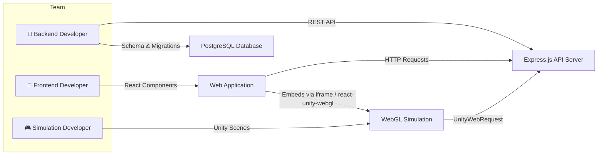
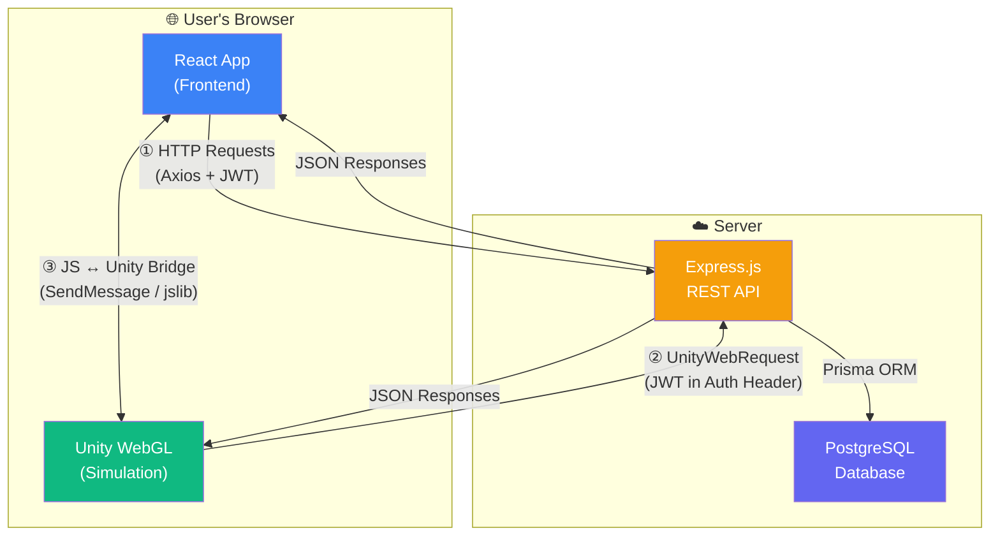
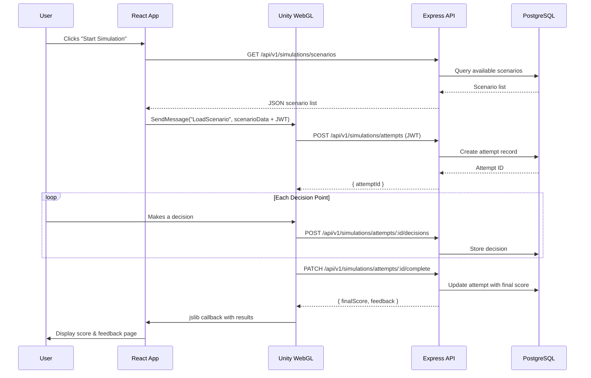

# DisasterReady — Team Responsibilities

> **Project:** DisasterReady — Disaster Awareness, Preparedness & Emergency Response Platform  
> **Team Size:** 3 Developers  
> **Last Updated:** November 2026

---

## Table of Contents

1. [Team Overview](#1-team-overview)
2. [Backend Developer Responsibilities](#2-backend-developer-responsibilities)
3. [Frontend Developer Responsibilities](#3-frontend-developer-responsibilities)
4. [Simulation (Unity) Developer Responsibilities](#4-simulation-unity-developer-responsibilities)
5. [Integration Points](#5-integration-points)
6. [Shared Responsibilities](#6-shared-responsibilities)
7. [Communication Guidelines](#7-communication-guidelines)

---

## 1. Team Overview

DisasterReady is developed by a focused 3-person team, with each member owning a distinct vertical of the platform. Clear ownership boundaries enable parallel development while well-defined integration contracts ensure all components work together seamlessly.

| #  | Role                      | Technology Stack                        | Primary Domain                              |
|----|---------------------------|-----------------------------------------|---------------------------------------------|
| 1  | **Backend Developer**     | Node.js, Express.js, PostgreSQL, Prisma | REST API, database, authentication, services |
| 2  | **Frontend Developer**    | React.js, Tailwind CSS                  | Public website, dashboards, UI/UX           |
| 3  | **Simulation Developer**  | Unity, C#                               | Disaster simulations, WebGL builds          |



> [!IMPORTANT]
> Each developer is the **primary owner** of their domain. Cross-domain changes must be coordinated through pull requests and team discussion.

---

## 2. Backend Developer Responsibilities

The Backend Developer owns the entire server-side stack — from database design through API delivery. All data flows in the platform pass through the backend.

### 2.1 Core Responsibilities

#### Database Design & Management
- Design and maintain the PostgreSQL schema using **Prisma ORM**
- Define all models, relations, indexes, and constraints in `prisma/schema.prisma`
- Write and manage **Prisma migrations** across development, staging, and production environments
- Create and maintain **seed scripts** for development and testing data
- Optimize queries and ensure proper indexing for performance

#### Express.js Architecture
- Establish and maintain the project structure following a layered architecture:
  - **Routes** → **Controllers** → **Services** → **Repositories/Prisma**
- Configure the middleware stack (body parsing, CORS, logging, compression)
- Implement environment-based configuration management (`.env`, config modules)

#### Authentication & Authorization
- Implement **JWT-based authentication** (access tokens + refresh tokens)
- Build a complete auth flow: registration, login, logout, token refresh, password reset
- Implement **role-based access control (RBAC)** for three roles:
  - `CITIZEN` — General public users
  - `AUTHORITY` — Government/emergency officials
  - `ADMIN` — System administrators
- Create reusable auth middleware for route protection
- Manage session lifecycle and token invalidation

#### REST API Development
- Implement all `/api/v1/*` endpoints as defined in [API_CONTRACTS.md](./API_CONTRACTS.md)
- Ensure consistent response format across all endpoints:
  ```json
  {
    "success": true,
    "message": "Description",
    "data": { }
  }
  ```
- Implement proper HTTP status codes (200, 201, 400, 401, 403, 404, 500)
- Support pagination, filtering, and sorting where applicable

#### Business Logic (Service Layer)
- Implement all domain-specific business logic in the service layer
- Key domains include:
  - **Alerts**: Creation, broadcasting, severity levels, geographic targeting
  - **Events**: Community event management, registration tracking
  - **Incidents**: Report submission, review workflow, status management
  - **Resources**: Emergency resource catalog, availability tracking
  - **Simulations**: Scenario management, attempt tracking, scoring, leaderboards
  - **Notifications**: In-app notification delivery and read status

#### Input Validation
- Validate all incoming request payloads using **Joi** or **Zod**
- Define reusable validation schemas for each endpoint
- Return clear, actionable validation error messages

#### Error Handling
- Implement a **centralized error handling middleware**
- Define custom error classes (`AppError`, `NotFoundError`, `ValidationError`, etc.)
- Ensure no stack traces leak in production responses
- Log errors with contextual information for debugging

#### Simulation API Integration
- Build dedicated endpoints for the Unity simulation game:
  - `GET /api/v1/simulations/scenarios` — List available scenarios
  - `POST /api/v1/simulations/attempts` — Start a new simulation attempt
  - `POST /api/v1/simulations/attempts/:id/decisions` — Record player decisions
  - `PATCH /api/v1/simulations/attempts/:id/complete` — Submit final score
  - `GET /api/v1/simulations/leaderboard` — Retrieve leaderboard data
- Coordinate with the Simulation Developer on payload structures and timing

#### Backend Testing
- Write **unit tests** for services and utility functions
- Write **integration tests** for API endpoints
- Aim for meaningful test coverage on critical paths (auth, scoring, data integrity)
- Use testing frameworks such as Jest and Supertest

#### Security Hardening
- Configure **CORS** with an appropriate origin whitelist
- Apply **Helmet.js** for HTTP security headers
- Implement **rate limiting** on auth and public-facing endpoints
- Sanitize all user inputs to prevent SQL injection and XSS

#### Documentation
- Maintain API documentation alongside code changes
- Keep [API_CONTRACTS.md](./API_CONTRACTS.md) up to date
- Optionally generate Swagger/OpenAPI specs for interactive documentation

### 2.2 Key Deliverables

| Deliverable                          | Description                                                     |
|--------------------------------------|-----------------------------------------------------------------|
| Functional REST API Server           | Express.js server with all endpoints operational                |
| Database Schema with Migrations      | Complete Prisma schema with versioned migrations                |
| Authentication System                | JWT auth with registration, login, refresh, and password reset  |
| Role-Based Access Middleware         | Reusable middleware enforcing CITIZEN / AUTHORITY / ADMIN roles  |
| All API Endpoints                    | Full implementation per [API_CONTRACTS.md](./API_CONTRACTS.md)  |
| Seed Scripts                         | Development and demo data seeding                               |
| Test Suite                           | Unit and integration tests for critical paths                   |

---

## 3. Frontend Developer Responsibilities

The Frontend Developer owns the entire client-side web application — every page the user sees and interacts with in the browser.

### 3.1 Core Responsibilities

#### Public Website
- **Landing Page**: Hero section, feature highlights, call-to-action, statistics
- **Disaster Awareness Hub**: Educational content, disaster types, safety guidelines
- **About Page**: Team information, project mission, contact details
- **Navigation**: Global header/footer, responsive navigation menu

#### Citizen Dashboard
Build the full citizen experience after login:
- **Personal Dashboard**: Overview cards, recent alerts, upcoming events, simulation stats
- **Alerts View**: Active alerts list with severity indicators, alert detail pages
- **Event Registration**: Browse community events, register/unregister, event details
- **Preparedness Kit**: Personalized checklists, emergency supply tracking
- **Simulation History**: Past simulation attempts, scores, performance trends
- **Incident Reporting**: Submit new incident reports with location, photos, description
- **Notification Center**: In-app notifications with read/unread status

#### Authority Dashboard
Build the administrative experience for emergency authorities:
- **Alert Management**: Create, edit, publish, and expire alerts; set severity and geographic scope
- **Event Management**: Create and manage community preparedness events
- **Incident Report Review**: View, triage, and update status of citizen-submitted reports
- **Resource Management**: Manage emergency resources, update availability and locations

#### Admin Panel *(if applicable)*
- **User Management**: View, search, and manage user accounts; assign roles
- **System Configuration**: Platform settings, feature flags

#### Authentication UI
- **Login Page**: Email/password login with validation and error display
- **Registration Page**: Multi-step or single-page registration with role selection
- **Forgot Password**: Password reset request and confirmation flow
- **Profile Management**: View and edit profile, change password

#### API Integration
- Connect all frontend views to backend REST APIs using **Axios** or **Fetch**
- Implement a centralized API client with:
  - Base URL configuration
  - JWT token attachment via interceptors
  - Automatic token refresh on 401 responses
  - Global error handling
- Handle loading states, error states, and empty states for every data-fetching view

#### Unity WebGL Integration
- Embed the Unity WebGL build within a React page using **iframe** or **react-unity-webgl**
- Pass the authenticated user's JWT token and context into the Unity instance
- Receive simulation results back from Unity and display them in the React UI
- Handle loading/progress indicators for the Unity WebGL bundle

#### Responsive Design
- Implement **mobile-first responsive design** using Tailwind CSS
- Ensure usability across mobile, tablet, and desktop breakpoints
- Test on major browsers (Chrome, Firefox, Safari, Edge)

#### Routing
- Configure client-side routing with **React Router v6+**
- Implement **protected routes** based on authentication state and user role:
  - Public routes: Landing, awareness hub, login, register
  - Citizen routes: `/dashboard/*`
  - Authority routes: `/authority/*`
  - Admin routes: `/admin/*`
- Implement route guards and redirect logic for unauthorized access

#### State Management
- Manage global application state using **Context API** or **Zustand**
- Key global state areas:
  - Auth state (user, tokens, role)
  - Notification state
  - Theme/UI preferences
- Use local component state for form data and UI interactions

#### Error Handling & UX
- Display user-friendly error messages (not raw API errors)
- Implement consistent loading skeletons or spinners
- Show meaningful empty states ("No alerts in your area", "No simulation history yet")
- Toast/snackbar notifications for success and error actions

#### Form Handling
- Implement form validation (client-side) with clear error messages
- Use controlled components or a form library (React Hook Form / Formik)
- Handle form submission states (submitting, success, error)

### 3.2 Key Deliverables

| Deliverable                          | Description                                                    |
|--------------------------------------|----------------------------------------------------------------|
| Complete Public-Facing Website       | Landing page, awareness hub, about page                        |
| Citizen Dashboard                    | All citizen features: alerts, events, kits, simulations, etc.  |
| Authority Dashboard                  | Alert, event, incident, and resource management interfaces     |
| Responsive, Accessible UI            | Mobile-first design tested across devices and browsers         |
| Integrated Unity Game Page           | WebGL simulation embedded with token passing and result display|
| Authentication Pages                 | Login, register, forgot password, profile management           |
| API Client                           | Centralized, token-aware HTTP client                           |

---

## 4. Simulation (Unity) Developer Responsibilities

The Simulation Developer owns the disaster simulation game — built in Unity and exported as a WebGL application that runs inside the browser.

### 4.1 Core Responsibilities

#### Unity Project Setup
- Establish a clean, maintainable Unity project structure:
  - `Assets/Scenes/` — One scene per disaster scenario + main menu
  - `Assets/Prefabs/` — Reusable game objects (player, hazards, UI elements)
  - `Assets/Scripts/` — C# scripts organized by domain (Player, Hazards, API, UI, Managers)
  - `Assets/Materials/`, `Assets/Textures/`, `Assets/Audio/`
- Configure project settings for WebGL platform target

#### Disaster Scenario Development
- Design and implement interactive disaster scenarios, including but not limited to:
  - 🏚️ **Earthquake**: Building collapse, falling debris, aftershock sequences
  - 🌊 **Flood**: Rising water levels, evacuation routing, rescue situations
  - 🌀 **Cyclone**: High winds, flying debris, shelter seeking
  - 🔥 **Fire** *(stretch goal)*: Fire spread mechanics, smoke navigation, evacuation
- Each scenario should include:
  - A defined objective (e.g., "Evacuate safely within the time limit")
  - Multiple decision points with branching consequences
  - Increasing difficulty through time pressure or escalating hazards

#### Player Mechanics
- Implement a first-person or third-person player controller:
  - Movement (WASD / arrow keys / on-screen joystick for mobile)
  - Camera control
  - Interaction system (pick up items, open doors, use equipment)
- Design an interaction/prompt system for decision points

#### Environment Design
- Create or source 3D environments appropriate to each disaster scenario:
  - Urban areas (buildings, roads, intersections)
  - Residential interiors
  - Natural terrain (rivers, hills, coastal areas)
- Optimize environments for **WebGL performance** (low poly, texture atlasing, LOD)

#### Physics & Hazards
- Simulate disaster physics within Unity's capabilities:
  - Falling debris and structural collapse (Rigidbody, colliders)
  - Rising water (shader-based or trigger-volume-based)
  - Fire spread (particle systems, trigger zones)
  - Wind effects (force fields, audio cues)
- Implement hazard zones that affect player health or trigger failure states

#### Gameplay Logic
- Build the core gameplay loop:
  1. **Scenario Briefing** → Player reads the situation
  2. **Active Phase** → Navigate the environment, encounter hazards
  3. **Decision Points** → Choose actions (e.g., "Take the stairs" vs. "Use the elevator")
  4. **Outcome** → Immediate feedback on each decision
  5. **Completion** → Final score and summary
- Manage game state transitions (menu → playing → paused → completed)
- Implement time pressure mechanics (countdown timers, escalating danger)

#### Scoring & Feedback
- Implement a real-time scoring system based on:
  - Decisions made (correct vs. suboptimal vs. dangerous)
  - Time taken to complete objectives
  - Items collected (first-aid kit, flashlight, etc.)
  - Survival outcome
- Track every decision with metadata (timestamp, decision ID, option chosen)
- Display post-game feedback:
  - Overall score and grade
  - Decision-by-decision breakdown
  - Tips for improvement based on mistakes

#### API Communication
- Use `UnityWebRequest` to communicate with the Express.js backend:
  ```
  GET  /api/v1/simulations/scenarios          → Fetch available scenarios
  POST /api/v1/simulations/attempts           → Start a new attempt
  POST /api/v1/simulations/attempts/:id/decisions → Submit a decision
  PATCH /api/v1/simulations/attempts/:id/complete → Submit final score
  GET  /api/v1/simulations/leaderboard        → Fetch leaderboard
  ```
- Attach the **JWT token** (received from React) in the `Authorization` header
- Handle network errors gracefully (retry logic, offline fallback, user feedback)
- Serialize/deserialize JSON payloads using `JsonUtility` or Newtonsoft JSON

#### Unity WebGL Export
- Configure Unity build settings for the **WebGL platform**:
  - Optimize build size (compression, code stripping, texture compression)
  - Configure memory allocation for browser constraints
  - Test on target browsers (Chrome, Firefox, Edge)
- Produce build artifacts (`Build/`, `TemplateData/`) for frontend embedding
- Coordinate with the Frontend Developer on build delivery and integration

#### UI/UX in Unity
- Design in-game UI elements using Unity UI (Canvas):
  - **HUD**: Health bar, score, timer, objective tracker
  - **Main Menu**: Scenario selection, settings, back-to-website button
  - **Decision Prompts**: Clear choice dialogs during gameplay
  - **Tutorials**: First-time player onboarding, control hints
  - **Results Screen**: Post-game score breakdown and feedback

### 4.2 Key Deliverables

| Deliverable                          | Description                                                    |
|--------------------------------------|----------------------------------------------------------------|
| 2–3 Disaster Simulation Scenarios    | Fully playable earthquake, flood, and/or cyclone scenarios     |
| WebGL Build                          | Optimized build deployable in a browser via React embedding    |
| API Integration                      | Full communication with backend for scenarios, decisions, scores|
| Scoring & Decision Tracking System   | Real-time scoring with per-decision granularity                |
| In-Game UI                           | HUD, menus, tutorials, decision prompts, results screen        |

---

## 5. Integration Points

The three components of DisasterReady are independently developed but tightly integrated at runtime. The following section defines how each pair communicates.



### 5.1 Frontend ↔ Backend

| Aspect            | Details                                                                 |
|-------------------|-------------------------------------------------------------------------|
| **Protocol**      | HTTP/HTTPS                                                              |
| **Data Format**   | JSON                                                                    |
| **Auth Mechanism** | JWT Bearer token in `Authorization` header                             |
| **API Base URL**  | `{BACKEND_URL}/api/v1`                                                 |
| **Error Contract** | Consistent error response shape with `success`, `message`, `errors`   |

- The React frontend calls backend REST APIs for **all** data operations (CRUD, auth, search)
- JWT tokens are stored securely (httpOnly cookies or in-memory) and attached to every authenticated request
- The frontend **never** accesses the database directly
- Token refresh is handled transparently via Axios interceptors

### 5.2 Unity ↔ Backend

| Aspect            | Details                                                                 |
|-------------------|-------------------------------------------------------------------------|
| **Protocol**      | HTTP/HTTPS via `UnityWebRequest`                                       |
| **Data Format**   | JSON                                                                    |
| **Auth Mechanism** | JWT Bearer token passed from React into Unity at initialization        |
| **Endpoints Used** | `/api/v1/simulations/*`                                               |

- Unity uses `UnityWebRequest` to call the **same REST API** that the frontend uses
- The JWT token is passed from the React host into Unity via a **URL parameter** or **JavaScript-to-Unity bridge**
- Unity sends player decisions and final scores to the backend for persistent storage
- Unity retrieves scenario data and leaderboard rankings from the backend

> [!CAUTION]
> **Unity NEVER connects directly to PostgreSQL.** All database interactions must go through the Express.js API layer. Direct database connections from WebGL are not possible and would be a critical security vulnerability.

### 5.3 Frontend ↔ Unity

| Aspect            | Details                                                                 |
|-------------------|-------------------------------------------------------------------------|
| **Embedding**     | `<iframe>` or `react-unity-webgl` library                              |
| **React → Unity** | `SendMessage(gameObject, method, data)` or URL parameters              |
| **Unity → React** | `.jslib` plugin calling `window.dispatchEvent` or callback functions    |

- The Unity WebGL build is **embedded** within a React page (e.g., `/dashboard/simulation`)
- **React → Unity**: The React app passes the JWT token, user ID, and selected scenario ID into Unity at load time
- **Unity → React**: Upon simulation completion, Unity sends results (score, decisions) back to React for display
- Communication uses the **JavaScript ↔ Unity bridge**:
  - React calls `unityInstance.SendMessage("GameManager", "StartScenario", jsonData)`
  - Unity calls JavaScript via `.jslib` plugins that invoke React callbacks

### 5.4 Data Flow Example — Complete Simulation Session



---

## 6. Shared Responsibilities

While each developer owns a distinct domain, the following responsibilities are shared by **all team members**.

### 6.1 Code Quality

| Practice               | Expectation                                                    |
|------------------------|----------------------------------------------------------------|
| **Code Reviews**       | Review PRs from teammates; approve or request changes          |
| **Code Style**         | Follow agreed linting and formatting rules (ESLint, Prettier)  |
| **Meaningful Commits** | Write clear, descriptive commit messages                       |
| **Clean Code**         | Readable, maintainable code with appropriate comments          |

### 6.2 Git Workflow

All team members must follow the agreed branching strategy:

```
main              ← production-ready code
├── develop        ← integration branch
│   ├── feature/backend-auth
│   ├── feature/frontend-dashboard
│   └── feature/unity-earthquake
```

- **Branch naming**: `feature/<domain>-<description>`, `bugfix/<domain>-<description>`
- **Pull requests**: All merges to `develop` require a PR with at least one reviewer
- **No direct commits** to `main` or `develop`
- **Resolve conflicts** in your own branch before requesting review

### 6.3 Documentation

- Update documentation when making changes that affect other team members
- Keep API contracts current when endpoints change
- Document setup steps for your component in the project README
- Maintain inline code comments for complex logic

### 6.4 Bug Fixing

- Each developer is responsible for fixing bugs in their own domain
- Cross-domain bugs should be discussed in team chat and assigned to the appropriate owner
- Critical bugs take priority over new feature development

### 6.5 Testing

- Each developer writes tests for their own domain
- Integration-level testing across boundaries is a shared effort
- Report test failures promptly to the affected developer

---

## 7. Communication Guidelines

Effective communication is critical for a 3-person team building an integrated platform. The following guidelines ensure smooth collaboration.

### 7.1 Tools & Channels

| Tool                | Purpose                                              |
|---------------------|------------------------------------------------------|
| **Discord / Slack** | Primary async communication — daily updates, Q&A     |
| **GitHub**          | Code reviews, issue tracking, PR discussions          |
| **Google Meet / Zoom** | Weekly sync meetings, ad-hoc screen sharing       |
| **Shared Drive**    | Design assets, documentation, meeting notes           |

### 7.2 Meeting Cadence

| Meeting               | Frequency  | Duration   | Purpose                                    |
|-----------------------|------------|------------|--------------------------------------------|
| **Weekly Sync**       | Weekly     | 30–45 min  | Progress updates, blocker discussion, planning |
| **Sprint Planning**   | Bi-weekly  | 1 hour     | Plan next sprint, assign tasks              |
| **Ad-hoc Debugging**  | As needed  | 15–30 min  | Resolve integration issues in real time     |

### 7.3 Communication Protocols

> [!IMPORTANT]
> Following these protocols prevents integration surprises and reduces debugging time.

- **PR Reviews**: Respond to pull request reviews **within 24 hours**
- **API Changes**: Notify the team **before** making any breaking API changes
  - Update [API_CONTRACTS.md](./API_CONTRACTS.md) first
  - Post in the team channel with a summary of changes
  - Allow 24 hours for feedback before merging
- **Breaking Changes**: Any change that affects another developer's component must be:
  1. Announced in the team chat
  2. Documented in the PR description
  3. Coordinated for simultaneous deployment if needed
- **Blockers**: Raise blockers immediately — do not wait for the weekly sync
- **Status Updates**: Post a brief daily update in the team channel:
  - ✅ What you completed
  - 🔄 What you're working on
  - 🚧 Any blockers

### 7.4 Integration Coordination

When working on features that cross integration boundaries:

1. **Agree on the contract first** — Define request/response shapes before coding
2. **Use mock data** — Frontend and Unity can develop against mock APIs while backend is in progress
3. **Test together** — Schedule a short call to test integration points end-to-end
4. **Version your APIs** — Use `/api/v1/` prefix; never break existing endpoints without coordination

---

## Appendix: Quick Reference — Who Owns What

| Component / Feature                | Owner                    |
|------------------------------------|--------------------------|
| PostgreSQL schema & migrations     | Backend Developer        |
| Express.js API server              | Backend Developer        |
| JWT authentication & RBAC          | Backend Developer        |
| REST API endpoints                 | Backend Developer        |
| Landing page & public website      | Frontend Developer       |
| Citizen dashboard                  | Frontend Developer       |
| Authority dashboard                | Frontend Developer       |
| React ↔ API integration            | Frontend Developer       |
| Unity WebGL embedding in React     | Frontend Developer       |
| Unity project & scenes             | Simulation Developer     |
| Disaster scenario gameplay         | Simulation Developer     |
| Scoring & decision tracking (game) | Simulation Developer     |
| Unity ↔ API integration            | Simulation Developer     |
| WebGL build & optimization         | Simulation Developer     |
| API contract definitions           | All (Backend leads)      |
| Git workflow & code reviews        | All                      |
| Documentation                      | All (own domain)         |

---

*This document should be reviewed and updated as the project evolves. All team members are expected to read and understand their responsibilities as well as the integration points with other components.*
